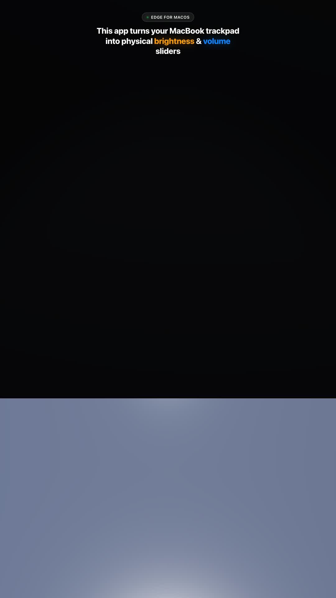
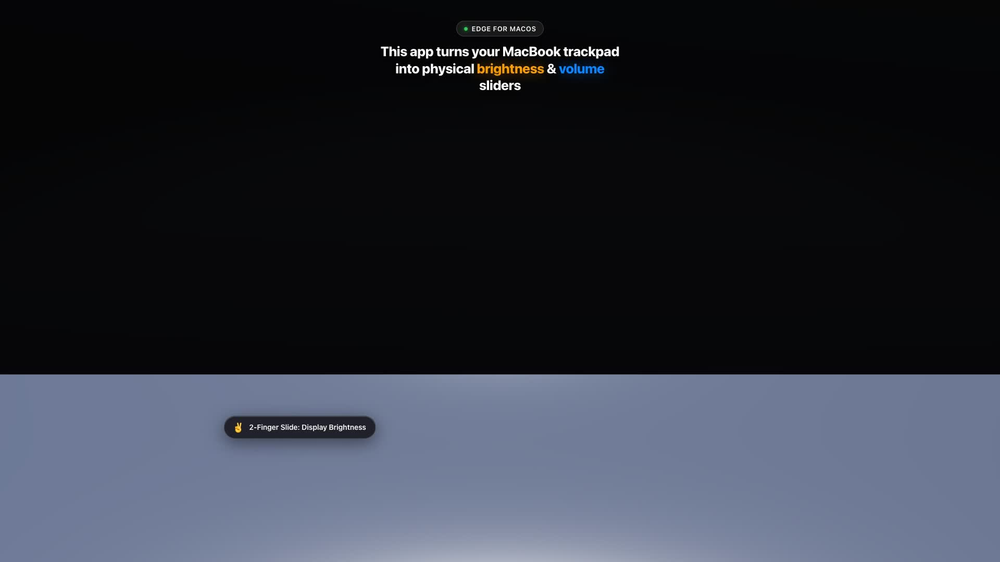
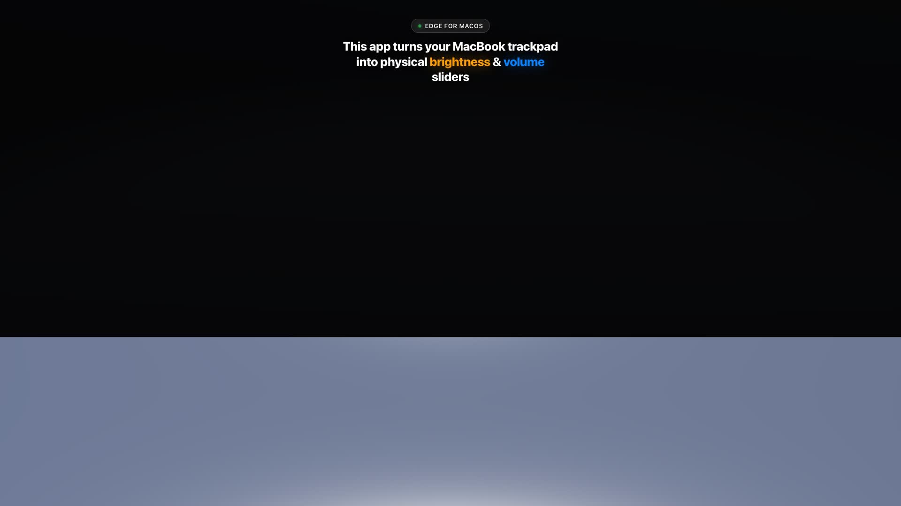

# Edge (Trackpad Edge Slider for macOS)

<p align="center">
  
</p>

A native macOS menu bar application that turns the physical boundaries of your MacBook trackpad or Magic Trackpad into precise hardware sliders for volume and screen brightness, with quick mute, media navigation, haptic feedback, and a floating liquid-glass OSD HUD.

Built in 100% pure Swift & SwiftUI with zero third-party framework dependencies.

---

## 3D Cinematic Visual Showcase

Edge includes a photorealistic 3D interactive simulator and high-converting video suite reverse-engineered from viral trackpad concept demonstrations, rendered at 60 FPS with Apple Keynote aesthetics:

| Viral Concept Reel (9:16) | Left Edge: Brightness (16:9) | Right Edge: Volume & Haptics (16:9) |
| :---: | :---: | :---: |
| [](showcase/videos/edge_concept_reel_1080x1920.mp4) | [](showcase/videos/edge_brightness_gesture_3d.mp4) | [](showcase/videos/edge_volume_gesture_3d.mp4) |
| [▶ Watch Reel (1080×1920)](showcase/videos/edge_concept_reel_1080x1920.mp4) | [▶ Watch Brightness (1080p)](showcase/videos/edge_brightness_gesture_3d.mp4) | [▶ Watch Volume (1080p)](showcase/videos/edge_volume_gesture_3d.mp4) |

### Interactive 3D Web Simulator
Launch the interactive 3D web experience in your browser to inspect the MacBook unibody, glass trackpad, biometric touch pucks, and liquid-glass HUD overlays with full 360° orbit controls:
```bash
open showcase/index.html
```
- **Switch Views:** Toggle between 9:16 Vertical Reel (Instagram/TikTok format) and 16:9 Landscape Widescreen.
- **Gesture Selector:** Play dedicated animations for Brightness, Volume & Haptics, Bottom Media Strip, or the full 16-second Master Concept Reel.
- **Interactive Orbit:** Rotate, pan, and zoom around the 3D model in real-time.

---

## Features

- **Two-Finger Edge Sliding:**
  - **Right Edge:** Smooth system volume adjustment via a 2-finger swipe with native OSD HUD feedback.
  - **Left Edge:** Display brightness adjustment via a 2-finger swipe with native OSD HUD feedback.
  - **Accidental Touch Immunity:** 2-finger sliding ensures your regular single-finger mouse cursor navigation never accidentally modulates volume or brightness.
  - **Swappable Sides:** Invert volume and brightness edges with one click in Settings.
- **Single-Finger Quick Mute:** Double-tap the top-right corner with 1 finger to instantly toggle mute and restore your prior audio volume level.
- **Bottom Media Strip:**
  - **Swipe Left/Right:** Skip forward or backward across tracks in Apple Music, Spotify, YouTube, etc. (supports configurable Reverse Swipe).
  - **Double-Tap:** Instant Play / Pause toggle.
- **Tactile Haptic Feedback:** Emits light ticks (`NSHapticFeedbackManager`) under your finger at each discrete volume / brightness step increment.
- **Fine / Precise Control:**
  - Hold **Shift + Option** while sliding to drop down to micro quarter-steps (1/64th step adjustments).
  - Or enable **Precise Sliding** in Settings for permanent micro-control without holding keys.
- **Triple-Layer Cursor Freeze:** Locks and hides the cursor while dragging along the edge, preventing pointer drift across the screen.
- **Active Area Constraints:** Restrict edge activation to the Entire Edge, Bottom 3/4, Bottom Half, or Bottom 1/4 (preventing accidental thumb activations near the top).
- **Interactive Trackpad Visualizer:** Live SwiftUI Settings panel displays real-time trackpad touch points and zone boundaries as you touch the glass.
- **Magic Mouse Support:** Optionally enable or isolate external Magic Mouse touch events.
- **Zero-Footprint Menu Bar Utility:** Operates as a background agent (`LSUIElement = true`) with dynamic status icons (`idle`, `tracking`, `paused`, `warning`), uses near-zero CPU and memory at idle, and supports **Open at Login** (`SMAppService`).
- **Battery-Optimized Low-Power Engine:**
  - **Dynamic Kernel CGEventTap Gating:** `CGEventTap` is enabled strictly when cursor freeze is engaged and immediately disabled on release, completely eliminating OS-wide mouse move IPC interrupts and context switches during normal usage.
  - **Zero-Allocation Touch Filtering:** Synchronous atomic check halts SwiftUI touch preview `Task` generation when the Settings window is closed.
  - **Timer-Free Sleep State:** Accessibility permission polling halts automatically as soon as trust is established, preventing runloop wakeups and allowing Apple Silicon cores to enter deep low-power sleep states (C-states).
  - **Lazy UI Rendering:** Settings and HUD windows are instantiated on-demand with deferred backing, keeping idle memory at ~12MB and idle CPU at a clean 0.0%.
- **Hide Menu Bar Icon Option:** Easily toggle menu bar icon visibility in Settings (`General -> Menu Bar`) for an ultra-minimalist, distraction-free desktop. When hidden, simply open Edge from Applications or Spotlight to access Settings.
- **Ultra-Responsive 120Hz CoreAudio HAL Pipeline:** Volume adjustments feature non-blocking asynchronous CoreAudio dispatch and intelligent corner-to-slide transition, ensuring silky smooth response with zero dropped frames.

---

## Architecture Overview

```
                               ┌──────────────────────────────────────────────┐
                               │       macOS MultitouchSupport Framework      │
                               └──────────────────────┬───────────────────────┘
                                                      │ raw contact frames (120Hz)
                                                      ▼
                               ┌──────────────────────────────────────────────┐
                               │               MultitouchBridge               │
                               │        (Thread-safe C-ABI callback)          │
                               └──────────────────────┬───────────────────────┘
                                                      │ normalized MTTouch frames
                                                      ▼
                               ┌──────────────────────────────────────────────┐
                               │              EdgeGestureEngine               │
                               │  - 4-State FSM (Idle -> Candidate -> Slide)  │
                               │  - Deadzone & Perpendicular cancellation     │
                               │  - Double-tap interval & distance detection  │
                               │  - Cursor Freeze & Haptic tick generation    │
                               └──────────────────────┬───────────────────────┘
                                                      │ EdgeGestureAction
                                                      ▼
                               ┌──────────────────────────────────────────────┐
                               │              EdgeAppCoordinator             │
                               │   (Coordinates hardware, UI, HUD, & status)  │
                               └──────┬───────────────┬───────────────┬───────┘
                                      │               │               │
             ┌────────────────────────┘               │               └────────────────────────┐
             ▼                                        ▼                                        ▼
    ┌─────────────────┐                      ┌─────────────────┐                      ┌─────────────────┐
    │ AudioController │                      │BrightnessManager│                      │  MediaManager   │
    │  (CoreAudio HAL)│                      │(DisplayServices)│                      │ (NX_SYSDEFINED) │
    └────────┬────────┘                      └────────┬────────┘                      └────────┬────────┘
             │                                        │                                        │
             └────────────────────────────────────────┼────────────────────────────────────────┘
                                                      │
                                                      ▼
                                             ┌─────────────────┐
                                             │   HUDManager    │
                                             │(Liquid-Glass OSD)
                                             └─────────────────┘
```

---

## Requirements

- **Operating System:** macOS 13.0 (Ventura) or newer (macOS 14 Sonoma, macOS 15 Sequoia, macOS 26/27 fully supported on Apple Silicon and Intel).
- **Permissions:** Accessibility access (`Privacy & Security -> Accessibility`), required for trackpad edge touch coordinates and cursor lock.

---

## Building and Packaging

### Quick Build & Run (CLI)
```bash
# Build with Swift Package Manager
swift build

# Run the background agent directly
swift run Edge
```

### Build the Standalone `.app` Bundle
Use the included bundling script to produce a release-ready, signed `Edge.app`:
```bash
./scripts/bundle.sh
```
This builds and places `Edge.app` in `build/Edge.app`.

To launch it immediately:
```bash
open build/Edge.app
```

---

## Automated Test Suite

Edge includes an extensive, 12-suite opaque-box test harness with synthetic multitouch frame injectors and hardware controller test doubles:
- **Baseline Feature Tests** (165 tests)
- **Boundary & Corner Tests** (35 tests)
- **Hardware & HUD Unit Tests** (21 tests)
- **Gesture Engine Unit Tests** (15 tests)
- **Multitouch Subsystem & Bridge Unit Tests** (14 tests)
- **Combination & Concurrency Tests** (10 tests)
- **Real-World Usage Scenarios** (7 tests)
- **Battery Efficiency & Low-Power Tests** (6 tests)
- **Preferences Unit Tests** (6 tests)
- **Trackpad Geometry Unit Tests** (6 tests)
- **Cursor & Haptics Unit Tests** (4 tests)
- **StatusBarController Unit Tests** (4 tests)

**Total:** **293 automated tests passing with 100% success rate (0 failures).**

Run the full test suite anytime:
```bash
swift test --no-parallel
```
